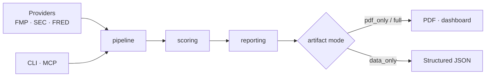

# Signal Foundry

> An engine that turns stock screening results into PDF-first research packets

[한국어](README.md) · [MIT License](LICENSE) · Python 3.11+

Once you've screened stocks, the work splits: shaping results into a report a person
reads, and handing structured data to another agent. Signal Foundry emits **a PDF for
people and MCP for agents from the same pipeline**.

**Both entry points share the same screening, scoring, and evidence pipeline.** It
leaves dashboard/HTML/JSON artifacts alongside only when asked.

## Architecture



## Quick start

```bash
python3 -m venv .venv
source .venv/bin/activate            # Windows: .\.venv\Scripts\Activate.ps1
python -m pip install --upgrade pip
pip install -e .[dev]
```

Generate a PDF only from an offline fixture:

```bash
python -m screener.cli run \
  --mode offline \
  --input tests/fixtures/base_snapshot.json \
  --output-dir out/demo \
  --artifact-mode pdf_only
```

Output: `out/demo/report.pdf`, `out/demo/run_manifest.json`

## Entry points

The package installs two entry points.

| Command | Purpose |
|---|---|
| `screener` | CLI, for people/operators |
| `screener-mcp` | Thin MCP server, for other agents |

## Artifact modes

| Mode | Audience | Files left |
|---|---|---|
| `pdf_only` (default) | People | `report.pdf`, `run_manifest.json` |
| `full` | Review | PDF + HTML/Markdown/`dashboard.html` + JSON data |
| `data_only` | Agents/pipelines | `input_snapshot.json`, `recommendations.json`, `evidence_packets.json`, `run_manifest.json` |

## Run modes

- `offline`: runs from a prepared snapshot JSON
- `live`: runs on real data via FMP / SEC (sec-api fallback) / FRED

```bash
python -m screener.cli run --mode live --output-dir out/live --artifact-mode pdf_only
```

If your plan can't use the FMP `company-screener` endpoint, it falls back to a built-in
basket. Specify your own universe with `--symbols-file symbols.txt`.

## AI copy generation

Choose `--llm-mode disabled` (template), `gemini`, or `openai`.

## MCP tools

```bash
screener-mcp
```

| Tool | Returns |
|---|---|
| `run_report` | PDF report path and manifest path (PDF-first) |
| `run_data` | manifest, recommendations, evidence packets (structured data) |

Recommended use: people/operators → CLI + `pdf_only`, other agents → MCP `run_report`,
data pipelines → MCP `run_data`.

## Configuration reference

Copy `.env.example` to `.env` and fill in what you need. All optional; required only for
`live`/LLM modes.

| Environment variable | Description |
|---|---|
| `SCREENER_FMP_API_KEY` | Live stock/financial data |
| `SCREENER_FRED_API_KEY` | Macro data |
| `SCREENER_SEC_USER_AGENT` | Identifying header for direct SEC queries |
| `SCREENER_SEC_API_KEY` | Alternate SEC filing-freshness source |
| `SCREENER_GEMINI_API_KEY` | Gemini copy generation |
| `SCREENER_OPENAI_API_KEY` | OpenAI copy generation |

## Windows PDF runtime

On Windows, WeasyPrint also needs the GTK/Pango/FontConfig runtime (MSYS2 recommended).
To point at the runtime DLLs directly, set `SCREENER_PDF_WINDOWS_DLL_DIRECTORIES`
(e.g. `C:\msys64\ucrt64\bin`).

## Development

```bash
python -m basedpyright   # type check
pytest                   # tests
```

## Disclaimer

All output is data to support investment judgment, not a recommendation to trade.

## License

[MIT](LICENSE) © 2026 AhnRyu
