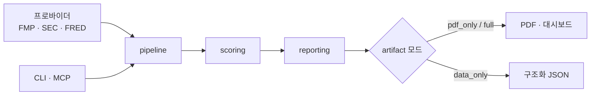

# Signal Foundry

> 주식 스크리닝 결과를 PDF 중심 리서치 패킷으로 만드는 엔진

[English](README.en.md) · [MIT License](LICENSE) · Python 3.11+

주식을 스크리닝하고 나면 결과를 사람이 읽을 리포트로 정리하는 일과, 다른 에이전트가
소비할 구조화 데이터로 넘기는 일이 갈린다. Signal Foundry는 **같은 파이프라인에서
사람에겐 PDF를, 에이전트에겐 MCP를** 내보낸다.

**두 진입점이 같은 스크리닝·스코어링·근거 파이프라인을 공유한다.** 필요할 때만
대시보드/HTML/JSON 산출물을 함께 남긴다.

## 아키텍처



## 빠른 시작

```bash
python3 -m venv .venv
source .venv/bin/activate            # Windows: .\.venv\Scripts\Activate.ps1
python -m pip install --upgrade pip
pip install -e .[dev]
```

오프라인 fixture로 PDF만 생성:

```bash
python -m screener.cli run \
  --mode offline \
  --input tests/fixtures/base_snapshot.json \
  --output-dir out/demo \
  --artifact-mode pdf_only
```

생성 결과: `out/demo/report.pdf`, `out/demo/run_manifest.json`

## 진입점

패키지는 두 진입점을 설치한다.

| 명령 | 용도 |
|---|---|
| `screener` | CLI. 사람/운영자용 |
| `screener-mcp` | 얇은 MCP 서버. 다른 에이전트용 |

## Artifact 모드

| 모드 | 대상 | 남는 파일 |
|---|---|---|
| `pdf_only` (기본) | 사람 | `report.pdf`, `run_manifest.json` |
| `full` | 검토 | PDF + HTML/Markdown/`dashboard.html` + JSON 데이터 |
| `data_only` | 에이전트·파이프라인 | `input_snapshot.json`, `recommendations.json`, `evidence_packets.json`, `run_manifest.json` |

## 실행 모드

- `offline`: 준비된 snapshot JSON으로 실행
- `live`: FMP / SEC(sec-api fallback) / FRED로 실데이터 실행

```bash
python -m screener.cli run --mode live --output-dir out/live --artifact-mode pdf_only
```

FMP `company-screener` endpoint를 쓰기 어려운 플랜이면 내장 종목 바스켓으로 fallback한다.
유니버스를 직접 지정하려면 `--symbols-file symbols.txt`를 준다.

## AI 문안 생성

`--llm-mode disabled`(템플릿) / `gemini` / `openai` 중 선택한다.

## MCP 도구

```bash
screener-mcp
```

| 도구 | 반환 |
|---|---|
| `run_report` | PDF 리포트 경로와 manifest 경로 (PDF 우선) |
| `run_data` | manifest, 추천 결과, evidence packet (구조화 데이터) |

권장 사용: 사람/운영자는 CLI + `pdf_only`, 다른 에이전트는 MCP `run_report`, 데이터 파이프라인은 MCP `run_data`.

## 설정 레퍼런스

`.env.example`을 복사해 `.env`를 만들고 필요한 값을 채운다. 전부 선택 사항이며 `live`/LLM 모드에서만 필요하다.

| 환경변수 | 설명 |
|---|---|
| `SCREENER_FMP_API_KEY` | live 종목/재무 데이터 |
| `SCREENER_FRED_API_KEY` | 거시 데이터 |
| `SCREENER_SEC_USER_AGENT` | SEC 직접 조회 식별 헤더 |
| `SCREENER_SEC_API_KEY` | SEC 대체 filing freshness 소스 |
| `SCREENER_GEMINI_API_KEY` | Gemini 문안 생성 |
| `SCREENER_OPENAI_API_KEY` | OpenAI 문안 생성 |

## Windows PDF 런타임

Windows에서는 WeasyPrint 외에 GTK/Pango/FontConfig 런타임이 필요하다 (MSYS2 권장).
런타임 DLL 경로를 직접 지정하려면 `SCREENER_PDF_WINDOWS_DLL_DIRECTORIES`에 넣는다
(예: `C:\msys64\ucrt64\bin`).

## 개발

```bash
python -m basedpyright   # 타입 체크
pytest                   # 테스트
```

## Disclaimer

모든 출력은 투자 판단 보조용 데이터이며 매매 권고가 아니다.

## License

[MIT](LICENSE) © 2026 AhnRyu
