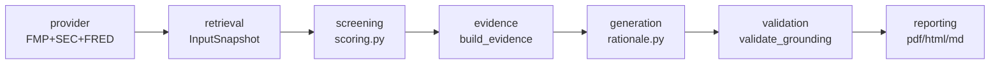

# signal-foundry

[한국어](README.ko.md)

[](https://github.com/ianlyoo/signal-foundry/actions/workflows/ci.yml)
[](LICENSE)
[](https://github.com/ianlyoo/signal-foundry/releases/tag/v0.1.0)
[](https://ianlyoo.github.io/signal-foundry/)

PDF-first stock screener and research packet generator — automate screening with MCP-ready data tools in measured market workloads.

> Companion repos: screening here, offline evaluation at [llm-eval-pipeline](https://github.com/ianlyoo/llm-eval-pipeline) and online RAG ops at [rag-ops-console](https://github.com/ianlyoo/rag-ops-console).

## Quick start — pdf and screening with mcp and retrieval

Install from tarball (version-pinned):

```bash
gh release download v0.1.0 --pattern "*.tgz" --repo ianlyoo/signal-foundry
npm install ./signal-foundry-*.tgz
```

From source with bun (frozen lockfile):

```bash
git clone https://github.com/ianlyoo/signal-foundry.git
cd signal-foundry
bun install --frozen-lockfile
bun run build
```

Python environment (primary runtime):

```bash
python -m venv .venv
# Windows alternative: .venv\Scripts\activate
pip install -e .[dev]
python -m screener.cli run --mode offline --input tests/fixtures/base_snapshot.json --output-dir out/demo
pytest -q
```

MCP server (research packet tools):

```bash
python -m screener.mcp_server --help
# exposes screening and packet tools for MCP clients
```

## Use cases for stock-screener and research-packet with stock-analysis

- **Stock screener** — deterministic ranking over tabular fundamentals (valuation/growth/quality/risk + macro overlay) selects 3+3 picks (safer_growth / higher_risk_higher_growth) with sector cap.
- **Research packet** — each pick emits 5 typed `EvidenceItem`s (valuation, growth, quality, risk, macro) with `as_of` and `source`, grounded via `validate_grounding()`.
- **Stock-analysis reporting** — Markdown/HTML/PDF outputs via `reporting.py` and `evidence_packets.json` + `run_manifest.json` for audit.
- **Retrieval and rag** — RAG-like tabular retrieval (no vector DB) loads `InputSnapshot` rows for the as-of date; the same role as a retriever, but over structured rows for offline reproducibility.
- **PDF pipeline** — WeasyPrint rendering with offline fixture `tests/fixtures/base_snapshot.json` for fully offline demo.

## Architecture: retrieval pipeline and screening pipeline with mcp

> `provider → retrieval → screening → evidence → generation → validation → reporting`



| RAG stage | Screener mapping | Module |
|---|---|---|
| Retrieval | RAG-like tabular retrieval — load snapshot rows | `pipeline.py:run_offline`, `io.py` |
| Reranking/Screening | Normalize + weight + macro overlay → Top-6 | `scoring.py:score_snapshot`, `select_top_six` |
| Evidence | 5 items per pick as only context for generation | `evidence.py:build_evidence` |
| Grounded generation | Evidence-only prompt → JSON rationale | `rationale.py:generate_rationale` |
| Validation | `evidence_refs ⊆ evidence` subset check | `rationale.py:validate_grounding` |
| Reporting | Markdown/HTML/PDF + packet/manifest | `reporting.py` |
| Tools | MCP-ready data tools | `mcp_server.py`, `providers/live_snapshot.py` |

Honest scope: RAG-like tabular retrieval uses no embedding index or ANN search — deterministic load of typed tables keeps the demo offline.

## Benchmark: screening and evaluation in measured market workloads

Measured execution (offline fixture `tests/fixtures/base_snapshot.json`):

- 6-pick invariant (3 safer_growth + 3 higher_risk_higher_growth) — `tests/test_pipeline.py`
- 5 evidence items per pick with `as_of` and `source`
- Citation validation (`validate_grounding()`) — raises on unsupported `evidence_refs`; LLM callers fallback to template with warning in `run_manifest.json`
- 3 modules, 12 cases — `pytest -q` offline, no network

Limitations adjacent to benchmark: RAG-like tabular retrieval — no embedding or ANN search; live snapshot requires FMP/SEC/FRED keys; scoring weights and macro overlay are deterministic heuristics, not financial advice; PDF output on Windows needs WeasyPrint GTK runtime; synthetic seed 42, one run per condition, policy may change, no billing.

## Project structure

```
signal-foundry/
├── src/screener/
│   ├── pipeline.py
│   ├── scoring.py
│   ├── evidence.py
│   ├── rationale.py
│   ├── reporting.py
│   ├── mcp_server.py
│   └── providers/live_snapshot.py
├── tests/fixtures/base_snapshot.json
├── docs/ (Pages: index.html, 404.html, sitemap.xml, robots.txt)
├── pyproject.toml
└── requirements
```

## Reproducibility

```bash
python -m screener.cli run --mode offline --input tests/fixtures/base_snapshot.json --output-dir out/demo
cat out/demo/evidence_packets.json | head -n 40
cat out/demo/run_manifest.json
```

Live mode needs `SCREENER_FMP_API_KEY`, `SCREENER_FRED_API_KEY`, `SCREENER_SEC_USER_AGENT` — see `pyproject.toml`.

## License

MIT — see [LICENSE](LICENSE).
