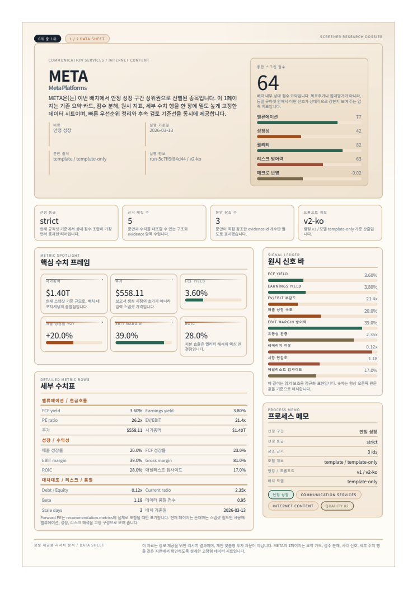
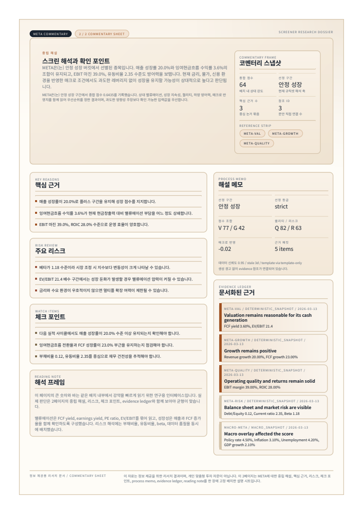

# Synthetic report rendering evidence

These two page captures come from tests/fixtures/base_snapshot.json and contain no live accounts or provider responses. The full report has 12 pages. The baseline bundled renderer failed because its recommendation metrics context was missing, so a before image could not be rendered. The PR records that baseline failure and the corrected test results.

